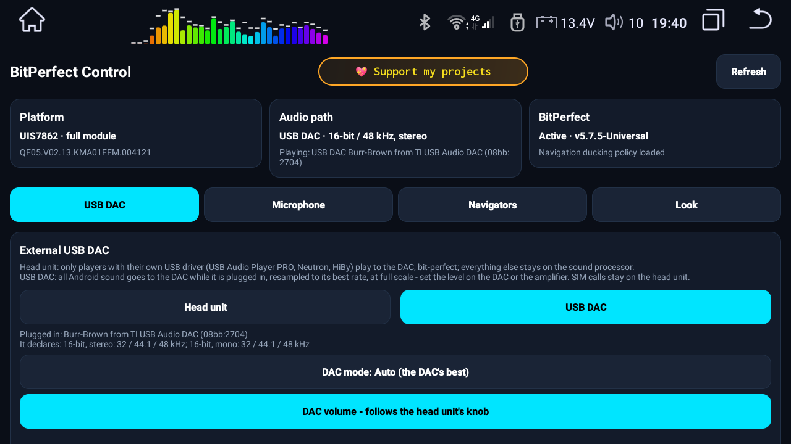
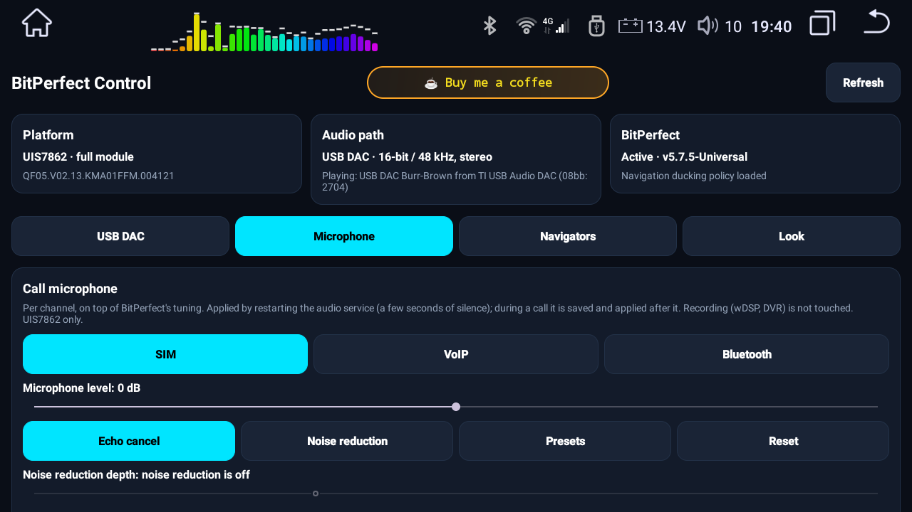
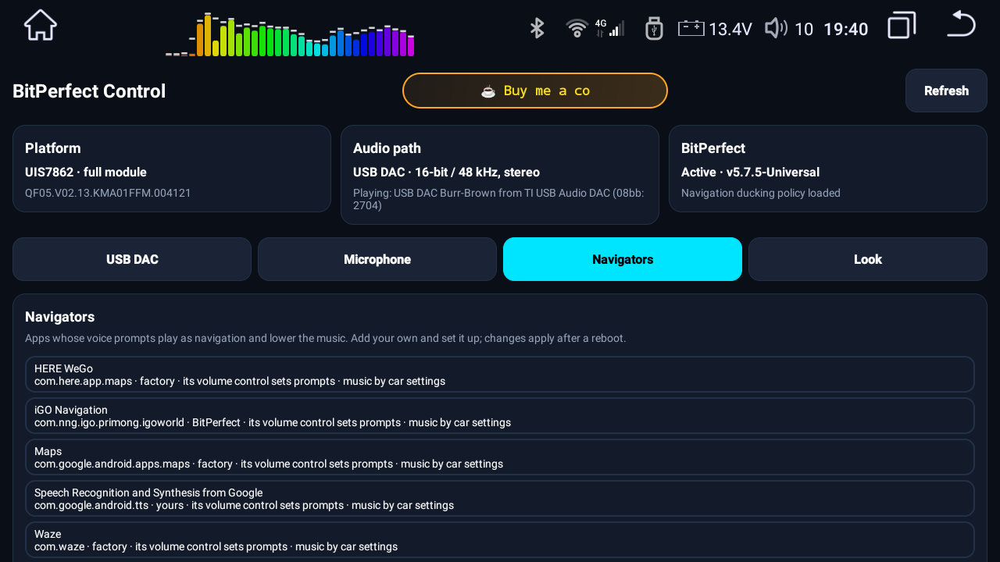
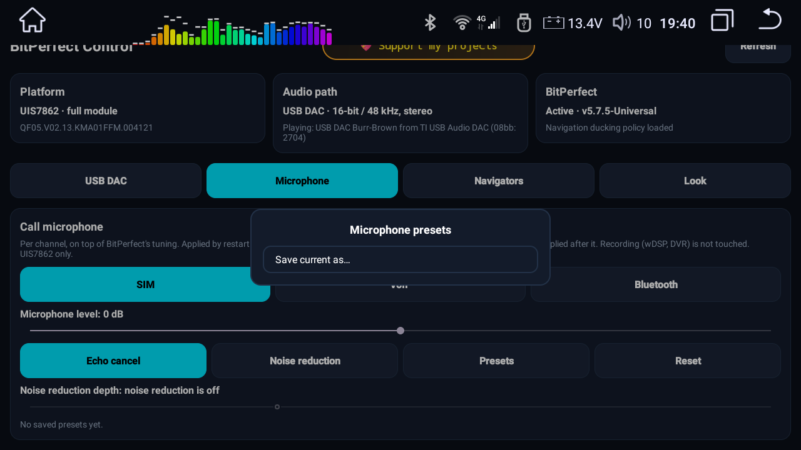

<h1 align="center">BitPerfect</h1>

<b>Bit-perfect audio engine for QF / Roco K706 head units</b> 
a Magisk module + its settings app, BitPerfect Control

  
  
  
  
  

  <a href="https://github.com/kostyamat/BitPerfec-Audio-Qf-module-Magisk/releases/latest"><b>⬇️ Download</b></a> ·
  <a href="docs/GUIDE.en.md"><b>📖 Guide</b></a> ·
  <a href="docs/GUIDE.uk.md"><b>📖 Посібник</b></a> ·
  <a href="CHANGELOG.md"><b>📝 Changelog</b></a> ·
  <a href="https://t.me/kostyamat_dev/3"><b>💬 Support group</b></a>

A Magisk module for QF / Roco K706 head units (and their MG clone) on **Unisoc UIS7862** — and, with a
reduced profile, **UIS8581**. It takes the sound from any player at full quality, with no attenuation and no change to the
frequency response, and hands it to the head unit's sound processor at **24 bit / 48 kHz, 0 dB**.
Volume and effects stay where they belong: in the sound processor.

<table>
  <tr>
    <td width="50%"></td>
    <td width="50%"></td>
  </tr>
  <tr>
    <td width="50%"></td>
    <td width="50%"></td>
  </tr>
</table>

## At a glance

| | |
|---|---|
| 🎚️ **Bit-perfect path** | one 24-bit / 48 kHz output at 0 dB into the sound processor (UIS7862); volume and effects on the chip |
| 🔌 **USB DAC** | switch at once, full scale from Android, level on the DAC's own control — optionally on the head unit's knob |
| 🎤 **Call microphone** | per channel (SIM, VoIP, Bluetooth): level, echo cancelling, noise reduction and its depth, presets |
| 🎙️ **Shared microphone** | several apps record at once — a dashcam next to wDSP Pro |
| 🧭 **Navigation** | prompts duck the music; add your own navigators |
| 📱 **BitPerfect Control** | what is really playing and where; every setting in one app; 25 languages |

⚖️ **Legal status / Right to Repair:** [LEGAL.md](LEGAL.md) (Ukrainian)

## Supported hardware

The installer reads the MCU code and picks the profile by itself.

| unit | output path | status |
|---|---|---|
| UIS7862 + **ROHM BU32107** | digital I2S, 24/48 | ✅ tested on the developer's unit |
| UIS7862 + **ROHM BD37xxx** | the SoC's own DAC (analogue), 24/48 by factory design | 🧪 needs reports |
| **UIS8581** | factory 16 bit / 44.1 kHz kept | 🧪 **reduced profile, untested** — see below |
| **any firmware other than QF or its MG clone** (Topway, FYT and the rest), whatever the SoC | — | ❌ **refused** — the installer accepts QF/MG only |

🧪 **UIS8581 — a reduced profile, never run on a unit.** Its audio HAL, libraries and vendor files are
different, so the module does far less there. Kept factory: the 16-bit / 44.1 kHz output (most music is
44.1, so it plays without resampling), the HAL's own sound parameters, effects and calls. Applied:
navigation prompts duck the music (also iGo and the navigators the factory list misses), the louder music
curve, the USB DAC setting. Each policy file is replaced only when the unit's factory file is exactly the
one the profile was built from; anything else stays factory. The "default volume" slider in car settings
stays yours — set it to **15 for 0 dB**. The UIS7862 patched libraries are never installed there. Reports
from 8581 owners (the snapshot plus `/data/adb/BitPerfect.log`) are what turns 🧪 into ✅.

🔴 **QF firmware (or its MG clone) only — everything else is refused.** Other vendors ship UIS7862 too,
with their own audio HAL and libraries; the module's patched files leave such a unit unable to boot (a
Topway owner needed a reflash). The installer accepts only a QF MCU string / hardware revision (`QF…` or
`MG…`) and refuses anything else.

## What it changes

- **Playback:** one 24-bit 48 kHz output, Android at unity gain (no digital attenuation before the
  sound processor), navigation ducking, louder VoIP calls on the speaker.
- **Calls:** SIM calls with handsfree echo cancellation and microphone headroom; Bluetooth calls with
  a louder microphone; Telegram / WhatsApp calls fixed (the factory VoIP record mode loops the input).
  The car-settings microphone sliders trim the level down from there.
- **Microphone for apps:** a raw, unprocessed input for DSP and voice apps (wDSP, assistants).
- Everything is overlaid by Magisk; no system partition is ever written.

## What changed since the classic v4.18

v4.18 was a single BU32107 profile — the full list of what changed since then

v4.18 was a single BU32107 profile. Since then:

**Hardware detection**
- The sound processor and the output path are read from the MCU code at the right positions (v4.x read
  the control-panel digits, so every BD37xxx unit got the BU32107 I2S profile — the "digital rasp").
- Two profiles: BU32107 (I2S) and BD37xxx (the SoC's DAC). The audio configuration is built from scratch
  for the detected hardware; no file of the other variant is left behind, also after an upgrade.
- 🔴 QF / MG firmware on UIS7862 (full) or UIS8581 (reduced profile); any other platform or firmware is refused.

**Playback**
- One 24-bit / 48 kHz output: the second output on the same PCM made `pcmC0D3p busy`, re-routed the bus
  under music and silenced TTS — gone.
- 0 dB that survives: the platform default volume is pinned at unity where the platform keeps it
  (`car.config`), not only in a property it rewrites at boot. The incoming-call ringtone is no longer
  played 18 dB down.
- The CarSettings start-up volume slider is never touched (v5.0/v5.1 overwrote it).
- The 24-bit I2S width is enforced only where an I2S bus exists, at boot and after sleep.
- After boot and after sleep the MCU gets the level of the current source.

**Navigation**
- Navigators that announce themselves as "assistant" are treated as navigation, not music.
- Google TTS prompts duck the music like navigation prompts.

**Calls**
- SIM: handsfree echo cancellation on the handset path, microphone ≈ +13 dB with the echo reference moved
  with it, the handset bass back.
- Bluetooth: louder microphone; the call stays at 0 dB, without a forced communication mode.
- Telegram / WhatsApp: the Unisoc VoIP record mode looped the microphone input (stutter, crackle,
  silence) — it is no longer switched on, and the apps use their own echo cancelling; VoIP is louder on
  the speaker at mid volume.
- The calling module (`qf_cellular_calling_master`) works only on top of BitPerfect, which confirms
  itself each boot (`sys.bitperfect.enabled=1`) once the policies are loaded and the audio path is alive.

**Microphone**
- Raw, unprocessed input for DSP apps (wDSP), voice recognition without echo cancelling or noise
  suppression (assistants); the vendor override that forced every app to the plain microphone is patched
  for these two sources.
- Headroom in every mode: the car-settings microphone sliders trim the level down without clipping.

**Reliability**
- The boot watchdog checks that the audio path really runs (a stream stranded after the platform's own
  audioserver restart), not only that the policies are loaded.
- Disable / remove is safe: a guard script restores the factory volume and audio parameters on the same
  boot, and redoes ours when the module is enabled again.
- On install a snapshot of the factory audio state is saved to `/sdcard/QF_audio_survey/`.

## Install, disable, remove

> [!CAUTION]
> **Magisk: use version 30.6 at most; 30.6 is the recommended one.** A kernel patched with Magisk works properly only up to 30.6; Magisk 31.1 and later do not support a kernel patched with Magisk 27.

Install the zip in Magisk and reboot. The installer saves a snapshot of your unit's factory audio state
to `/sdcard/QF_audio_survey/` before it changes anything — it stays on your unit unless you send it.

**Updates:** Magisk itself shows an **Update** button for BitPerfect when a new release is published here
(`updateJson` in `module.prop`, changelog in [CHANGELOG.md](CHANGELOG.md)).

Disabling or removing the module in Magisk is safe: a small guard script
(`/data/adb/post-fs-data.d/bitperfect_guard.sh`) restores the factory default volume and audio
parameters on the next boot, so the factory path does not play at full scale. Removing the module also
removes the guard.

## BitPerfect Control (the app)

The module installs **BitPerfect Control** (`/system/priv-app`). It shows what BitPerfect is doing on your unit
(platform, what is really playing and where, whether the module confirmed itself this boot) and holds every
setting in tabs: **USB DAC**, **Microphone** (call microphone per channel: level, echo cancelling, noise reduction and
its depth, presets), **Navigators** (your own navigators and how their prompts behave) and **Look** (Modern day/night,
Hyper). It asks for root once (Magisk prompt) and changes nothing by itself - every action goes through the module.
Details and pictures: [docs/GUIDE.en.md](docs/GUIDE.en.md).

## USB DAC (external)

QF firmware switches Android's USB audio output off (one commented-out line in the vendor audio
policy). BitPerfect lets you choose — in the app (tab **USB DAC**, applied at once) or in
**`/sdcard/BitPerfectAudio/bitperfect.conf`** (`usb_dac`, edit and reboot):

| `usb_dac` | what plays on the DAC |
|---|---|
| `0` (default) | only players with their own USB driver — USB Audio Player PRO, Neutron, HiBy "USB exclusive" — bit-perfect at any rate; everything else stays on the head unit's sound processor |
| `1` | all Android sound while the DAC is plugged in, resampled to the DAC's best rate; Android volume stays at full scale, so set the level on the DAC or the amplifier. SIM calls stay on the head unit |

With the USB DAC output on, Android sends the DAC **full scale**; the level is set by the DAC's own volume
control, optionally following the head unit's volume knob (`usb_dac_volume=follow`). A DAC without its own control
plays at full level. The DAC mode (`usb_dac_mode`) is its best format or a fixed one from its own list. The DAC is
silent while the ignition is off. Tested with a PCM2704 (16-bit); reports from other DACs welcome.

## Feedback — what to send

💬 **Support group (Telegram):** https://t.me/kostyamat_dev/3 — reports go there.

"It does not work" cannot be fixed without data. Please send:

1. `/sdcard/QF_audio_survey/` — the factory snapshot the installer made;
2. `/data/adb/BitPerfect.log`;
3. **for navigation-prompt problems (too quiet, cut off, music not ducked), for BD37xxx units, and for
   any other sound problem:** a live report from the diagnostic tool below, taken with
   BitPerfect installed and with the navigator you actually use.

### Diagnostic tool: `tools/QF_audio_survey.v1.4.zip`

A diagnostic Magisk module: it plays nothing and sends nothing by itself. It writes a report to
`/sdcard/QF_audio_survey/`: audio configuration, mixer state, every audio stream, what format and gain
Android feeds the HAL, the installed navigators, what happens while a navigator speaks (which app, how it
plays, every volume at that moment — any navigator, also those that take no audio focus), and since v1.4
**what a recorder really gets from the microphone**: the input source, the input mode the HAL chose, the
capture stream, and on UIS8581 the HAL's own recording before its processing and after its noise reduction
(identical files = the "unprocessed" input is really untouched). The only thing it touches: the HAL's
recording dump, on for about 10 seconds during that check and then off again.

1. Install it in Magisk (BitPerfect stays installed) and reboot.
2. Play music or radio, start your navigator and let it speak **once**.
3. Then open wDSP and start its microphone (or any voice recorder) for about 15 seconds, talking near the mic.
4. In Magisk the tool's line shows `DONE` (or `DONE (partial)` without a prompt within 7 minutes).
5. Zip `/sdcard/QF_audio_survey/` and send it. Then remove the tool.

## Repository

The module payload is `META-INF`, `common`, `profiles`, `system`, `customize.sh`, `module.prop`,
`service.sh`. `control-app/` is the source of BitPerfect Control, `docs/` the user guide and `.agents/` the
development notes — none of them is part of the module zip.

## Support the developer

  <a href="https://www.paypal.com/paypalme/kostyamat">
    
     
    <strong>If you found my work helpful, buy me a coffee! It keeps me motivated ☕</strong>
  </a>

🏆 If you appreciate my work and want to buy me coffee/beer - your choice, or purchase licenses for some paid products that I offer, here is a link to some of my payment details.
👇

**Crypto**
- TRC-20 (Tron): `TCSvCEyX1Zxb9E97oTpxHsBCLiDZLPTvzk`
- TON (Telegram wallet): `UQCqracCOo_DEwVWQjPVYkKak-gSZx1TXQOxICi_9frpdr5j`

**PayPal** (Please send your PayPal payment via 'Friends and Family'. If you select 'Goods and Services', PayPal charges a large fee and forces me to create shipping information, which delays the process.)
https://www.paypal.com/paypalme/kostyamat

**Revolut**
https://revolut.me/kostyamat
