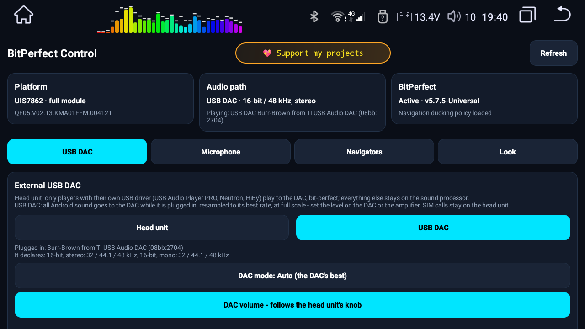
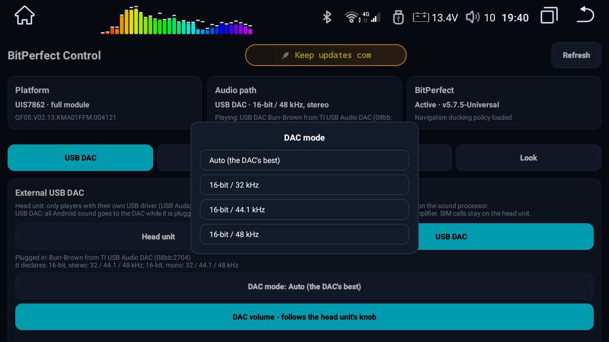
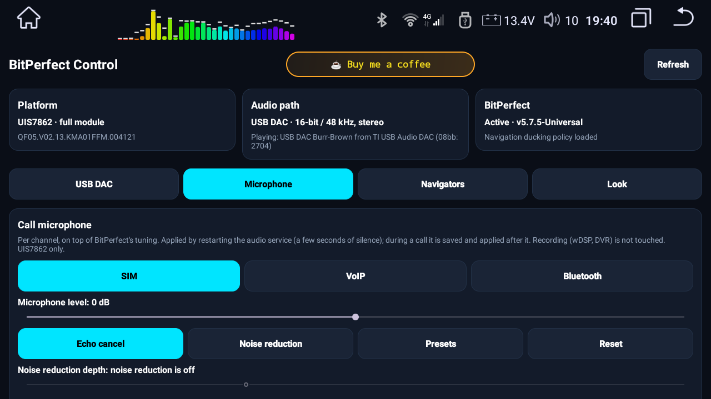
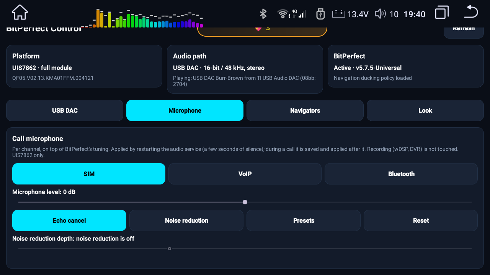
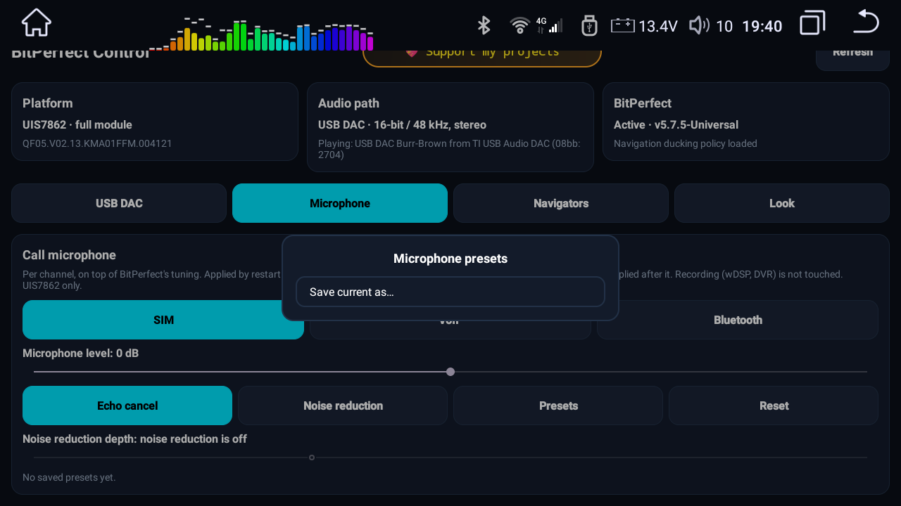
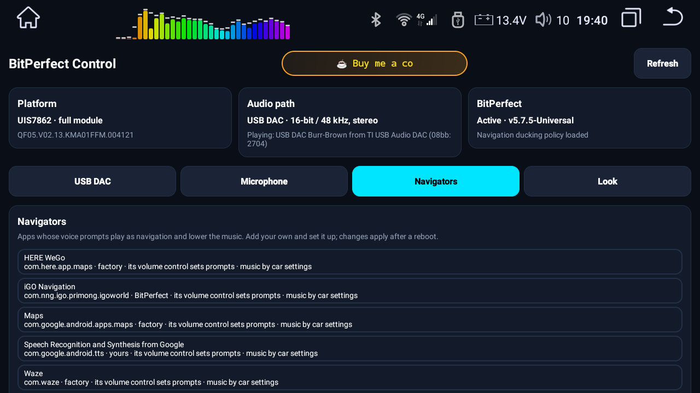
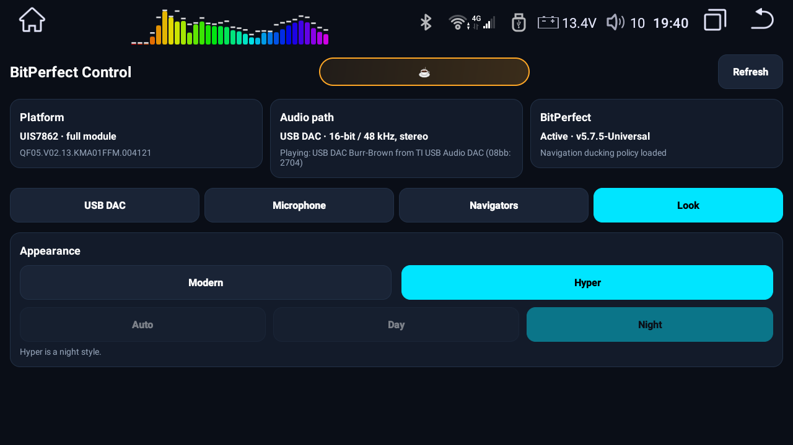

# BitPerfect v5.7.7 — user guide

🇺🇦 [Українською](GUIDE.uk.md)

BitPerfect is a Magisk module for **QF / Roco K706 head units (QF firmware or its MG clone only)**. On UIS7862 it
gives Android one clean path to the sound processor: 24-bit / 48 kHz at 0 dB, with volume and effects left to the
sound processor chip. On UIS8581 it applies a reduced profile and keeps the factory 16-bit / 44.1 kHz output.

The module ships its own settings app, **BitPerfect Control**. Everything below can be set from the app; the same
settings are plain text files in `/sdcard/BitPerfectAudio/`, listed at the end.

---

## 1. Install, update, disable, remove

> [!CAUTION]
> **Magisk app: use version 30.6.** With the older app 27 the module may not install completely; with 31.1 and later, apps do not get root (they do not support a kernel patched with Magisk 27).

1. Magisk → Modules → **Install from storage** → `QF_BitPerfect.module.v5.7.7-Universal.zip` → reboot.
   The installer prints in English what it found and what it changed. Any firmware that is not QF or MG is refused
   and nothing is changed.
2. **Updates:** Magisk shows an **Update** button for BitPerfect when a new release is published.
3. **Disable / remove** in Magisk and reboot. A small guard restores the factory volume and audio parameters on
   that same boot, so the factory path never plays at full scale.

Your settings in `/sdcard/BitPerfectAudio/` survive updates and reinstalls.

## 2. BitPerfect Control — the app

Open **BitPerfect Control** from the launcher. On first start Magisk asks for root once: allow it. The app changes
nothing by itself; every action is carried out by the module.

**No root?** The app says so in red, hides the settings and shows **Open Magisk**: it opens Magisk on the Superuser screen, you switch
BitPerfect Control on and come back, and the app asks again by itself. An app already running keeps its root until it is closed.

**Status cards** (top row, refreshed every few seconds):

| card | what it tells you |
|---|---|
| **Platform** | the chip (UIS7862 full module / UIS8581 reduced profile) and your firmware |
| **Audio path** | what is really playing right now and where: the head unit or the USB DAC, bit depth, rate, channels |
| **BitPerfect** | whether the module confirmed itself on this boot, its version, whether the navigation ducking policy is loaded |

Below them the settings are grouped in **tabs**: USB DAC, Microphone, Navigators, Look. The app remembers the
last tab. **Refresh** reads everything again.

## 3. USB DAC

Plug a USB DAC into the head unit (directly or through its hub).

**Where Android plays:**

| button | what plays on the DAC |
|---|---|
| **Head unit** (default) | only players with their own USB driver (USB Audio Player PRO, Neutron, HiBy "USB exclusive") — bit-perfect at any rate. All other sound stays on the head unit's sound processor. |
| **USB DAC** | all Android sound while the DAC is plugged in. SIM calls stay on the head unit. |

Switching takes a few seconds (the audio service restarts); no reboot and no replugging is needed.

Under the buttons the app shows the DAC **as it describes itself**: its name, its USB id and the formats it
declares. What the DAC declares is its maker's claim.

**DAC mode** — the format Android sends to the DAC:

- **Auto (the DAC's best)** — everything is mixed and resampled to the best format the DAC declares.
- **A fixed format** (e.g. 16-bit / 44.1 kHz) — chosen from the DAC's own list; use it for 44.1 kHz music without
  resampling. A mode the plugged DAC does not declare is refused.

Mixing is not bit-to-bit: several sounds are combined into one stream. A per-source bit-to-bit mode is planned for
the next version.

**Volume.** Android always sends the DAC **full scale** — nothing is attenuated in Android. The level is set
inside the DAC by its own volume control, after the full 16/24-bit word has arrived:

- **DAC volume — follows the head unit's knob** *off*: the DAC plays at full level; set the volume on your
  amplifier.
- **DAC volume — follows the head unit's knob** *on*: the head unit's volume knob (0..32) drives the DAC's own volume
  control; mute and 0 silence the DAC. After a start the DAC takes the head unit's default volume, not full level.
- A DAC **without its own volume control** always plays at full level — Android will not cut its signal. The app
  says so and greys the switch out.

**Volume curve.** With the knob following on, the tab shows five sliders: where knob positions 1, 8, 16, 24 and 32 land on this DAC's own
scale, in percent. DACs differ (steps, range, what is audible where), so tune it by ear with music on:

- it applies as soon as you let go of the slider, and it is kept per DAC model: plug another DAC and it has its own curve;
- moving a slider stretches the ones to its right; those to its left stay, so build the curve from left to right;
- two sliders never share a level, and **Reset** returns to even steps;
- the line above the sliders shows where the knob is now and which DAC step that gives.

**Ignition off:** a DAC with its own volume control goes silent as soon as the ignition is off and plays again when
it is back on. (While the unit counts down to sleep, the system plays a tick every second; through a DAC that was a
loud beep.)

## 4. Call microphone (UIS7862)

Settings for the microphone **in calls**, separately for each channel. Recording apps (wDSP Pro, dashcams) get the
raw microphone and are not affected.

| channel | what it is |
|---|---|
| **SIM** | cellular calls through the head unit's modem |
| **VoIP** | Telegram, WhatsApp and other internet calls |
| **Bluetooth** | calls through a phone connected over Bluetooth |

For the selected channel:

- **Microphone level** −12..+12 dB, relative to BitPerfect's tuning. Applied when you let go of the slider.
- **Echo cancel** — on/off.
- **Noise reduction** — on/off.
- **Noise reduction depth** −3 dB (gentle, left) … −24 dB (strong, right). BitPerfect's own setting is −10.5 dB.
  Greyed out while noise reduction is off.
- **Reset** — the channel back to BitPerfect's tuning.

**Presets** keep the whole set — all three channels with level, echo cancel, noise reduction and depth — under a
name of your choice. **Save current as…** stores it; tap a saved preset to **Load** or **Delete** it.

Every change restarts the audio service: a few seconds of silence. During a call the change is saved and applied
after the call, because a call would not survive the restart. Judge the result on a real call.

## 5. Navigators

Apps listed here are navigators for the head unit: their voice prompts play as navigation and lower the music.

Each line shows the app, where its entry comes from (*factory*, *BitPerfect*, or *yours*) and its two settings:

- **its volume control sets prompts** — the navigator's own volume slider changes the prompt volume;
- **music under prompts** — as in the car settings, or a fixed percentage.

**Add navigator** picks an installed app and sets both. Tap a line to **Change** it or **Remove from my list**
(a factory or BitPerfect entry then comes back as it was). **Show all** lists navigators that are not installed too.
Changes apply **after a reboot**.

## 6. Look

- **Modern** — Auto (follows the car's day/night), Day or Night.
- **Hyper** — a night style.

## 7. The settings files

All in `/sdcard/BitPerfectAudio/`, written by the app; you may also edit them by hand (then reboot).

| file | what is in it |
|---|---|
| `bitperfect.conf` | `usb_dac=0/1` (Head unit / USB DAC), `usb_dac_mode=auto` or `S16_LE/44100` etc., `usb_dac_volume=full/follow`, `usb_dac_curve_<vid>_<pid>=a,b,c,d,e` (the curve of one DAC model) |
| `mic.conf` | one line per change: `<SIM\|VOIP\|BT> <gain_db -12..12 \| aec 0/1 \| nr 0/1 \| nr_depth -24..-3> <value>` |
| `mic.preset.<name>.conf` | a saved microphone preset, same lines |
| `navigators.conf` | your navigators: `<package> <true/false> <appset or 0..100>` |

The module's own log: `/data/adb/BitPerfect.log`.

## 8. Feedback

💬 Support group: https://t.me/kostyamat_dev/3

With a report, send `/sdcard/QF_audio_survey/` (the factory snapshot the installer made) and
`/data/adb/BitPerfect.log`. For navigation-prompt problems, BD37xxx units or other sound problems, also a report from
`tools/QF_audio_survey.v1.4.zip` (see the README).
