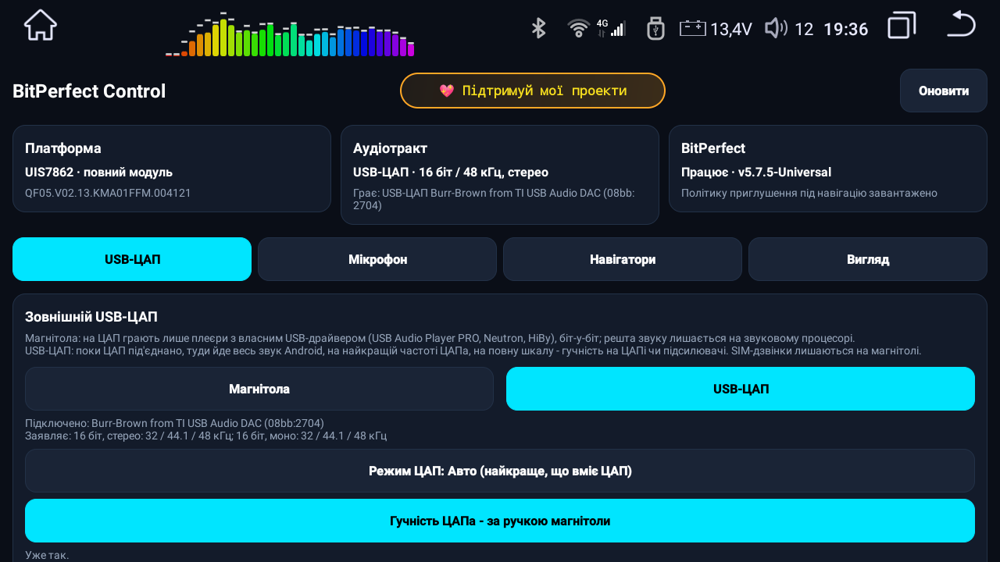
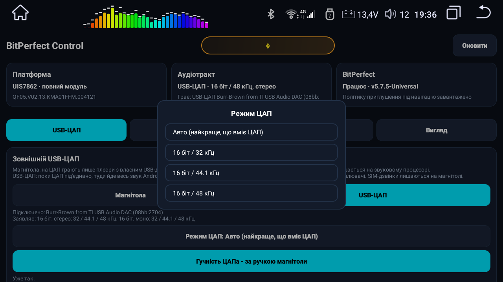
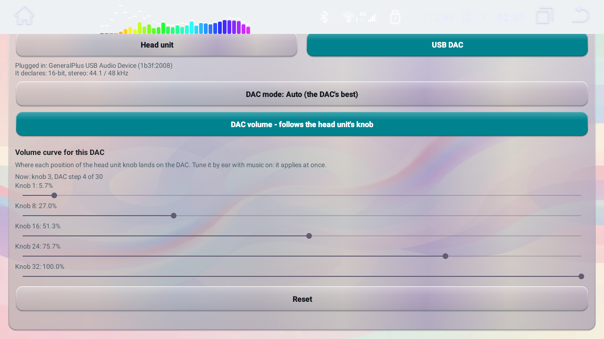
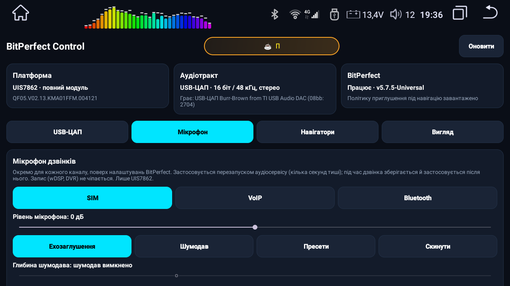
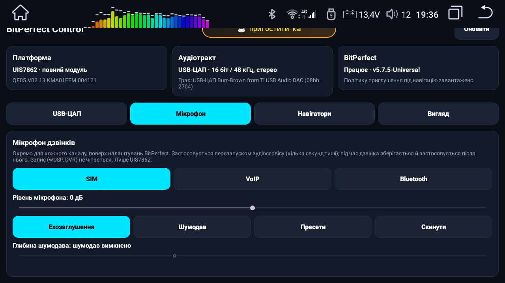
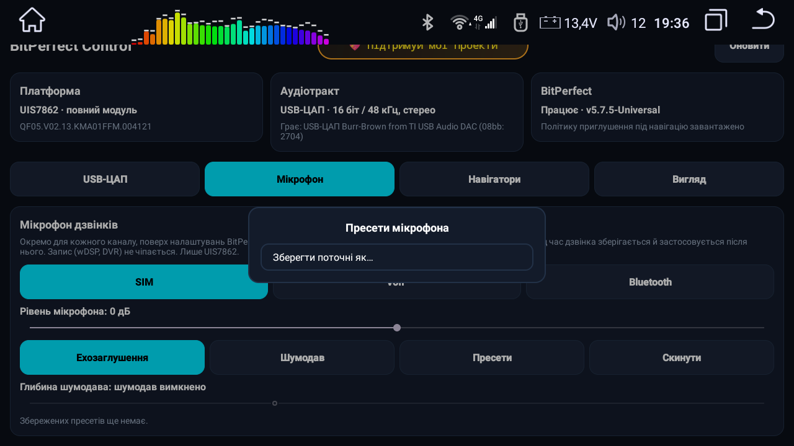
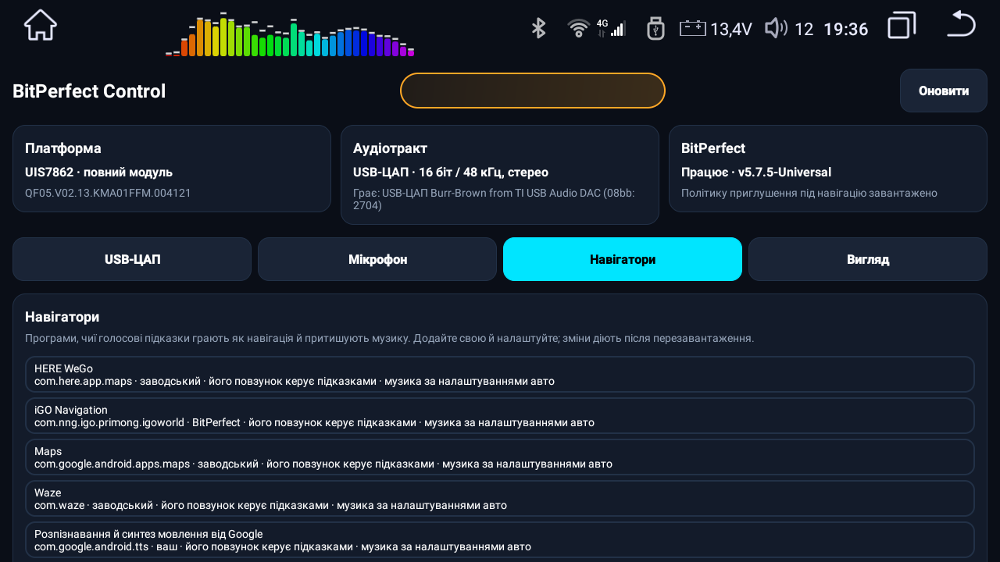
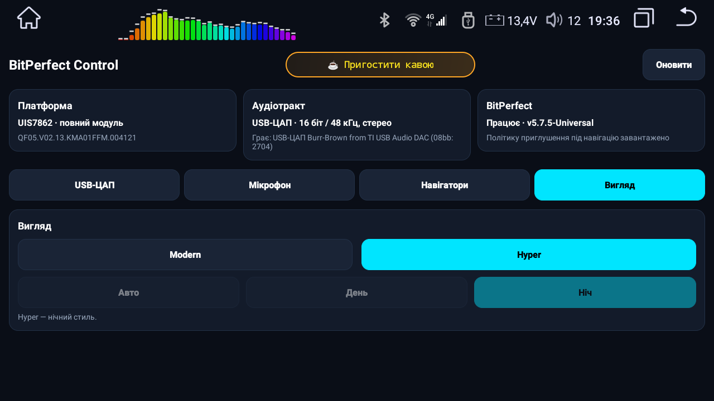

# BitPerfect v5.7.7 — посібник

🇬🇧 [English](GUIDE.en.md)

BitPerfect — модуль Magisk для магнітол **QF / Roco K706 (лише прошивка QF або її клон MG)**. На UIS7862 він дає
Android один чистий тракт у звуковий процесор: 24 біти / 48 кГц на 0 дБ, а гучність і ефекти лишаються на чипі
звукового процесора. На UIS8581 — зменшений профіль, заводський вихід 16 біт / 44.1 кГц зберігається.

Разом із модулем ставиться програма налаштувань **BitPerfect Control**. Усе описане нижче налаштовується з неї;
ті самі налаштування лежать звичайними текстовими файлами в `/sdcard/BitPerfectAudio/` (список — у кінці).

---

## 1. Встановлення, оновлення, вимкнення, видалення

> [!CAUTION]
> **Програма Magisk: версія 30.6.** Зі старішою 27 модуль може поставитись не повністю; із 31.1 і новішими програми не отримують root (вони не підтримують ядро, патчене Magisk 27).

1. Magisk → Модулі → **Встановити зі сховища** → `QF_BitPerfect.module.v5.7.7-Universal.zip` → перезавантаження.
   Інсталятор англійською пише, що знайшов і що змінив. Прошивку, яка не QF і не MG, він відкидає і нічого не міняє.
2. **Оновлення:** Magisk сам показує кнопку **Оновити** для BitPerfect, коли виходить новий реліз.
3. **Вимкнення / видалення** в Magisk і перезавантаження. Сторож того ж завантаження повертає заводські гучність і
   параметри звуку, тож заводський тракт ніколи не заграє на повну.

Ваші налаштування в `/sdcard/BitPerfectAudio/` переживають оновлення й перевстановлення.

## 2. BitPerfect Control — програма

Відкрийте **BitPerfect Control** із лаунчера. На першому старті Magisk один раз питає root — дозвольте. Сама
програма нічого не змінює: кожну дію виконує модуль.

**Немає root?** Програма пише це червоним, ховає налаштування і показує **Відкрити Magisk**: кнопка відкриває Magisk на екрані
Суперкористувач, ви вмикаєте BitPerfect Control, повертаєтесь, і програма сама питає ще раз. Уже запущена програма тримає root, доки її не закрити.

**Картки стану** (верхній ряд, оновлюються кожні кілька секунд):

| картка | що показує |
|---|---|
| **Платформа** | чип (UIS7862 — повний модуль / UIS8581 — зменшений профіль) і вашу прошивку |
| **Аудіотракт** | що й куди грає просто зараз: магнітола чи USB-ЦАП, розрядність, частота, канали |
| **BitPerfect** | чи модуль підтвердив себе на цьому старті, його версія, чи завантажено політику приглушення під навігацію |

Під ними налаштування розкладено по **вкладках**: USB-ЦАП, Мікрофон, Навігатори, Вигляд. Програма пам'ятає
останню вкладку. **Оновити** перечитує все заново.

## 3. USB-ЦАП

Під'єднайте USB-ЦАП до магнітоли (напряму або через її хаб).

**Куди грає Android:**

| кнопка | що грає на ЦАПі |
|---|---|
| **Магнітола** (за замовчуванням) | лише плеєри з власним USB-драйвером (USB Audio Player PRO, Neutron, HiBy «USB exclusive») — біт-у-біт на будь-якій частоті. Решта звуку лишається на звуковому процесорі магнітоли. |
| **USB-ЦАП** | увесь звук Android, поки ЦАП під'єднано. SIM-дзвінки лишаються на магнітолі. |

Перемикання займає кілька секунд (перезапуск аудіосервісу); ні перезавантаження, ні перепідключення ЦАПа не треба.

Під кнопками програма показує ЦАП **так, як він сам себе описує**: ім'я, USB-ідентифікатор і заявлені формати.
Що ЦАП заявляє — то слова його виробника.

**Режим ЦАП** — формат, який Android шле на ЦАП:

- **Авто (найкраще, що вміє ЦАП)** — усе змішується й перераховується в найкращий формат, який заявляє ЦАП.
- **Конкретний формат** (наприклад 16 біт / 44.1 кГц) — вибирається з власного списку ЦАПа; для музики 44.1 кГц без
  перерахунку частоти. Режим, якого під'єднаний ЦАП не заявляє, програма не прийме.

Змішування — не біт-у-біт: кілька звуків складаються в один потік. Біт-у-біт від кожного джерела — у наступній
версії.

**Гучність.** Android завжди віддає ЦАПу **повну шкалу** — в Android нічого не притишується. Рівень задається
всередині ЦАПа його власним регулятором, уже після того, як туди прийшло повне 16/24-бітне слово:

- **Гучність ЦАПа — за ручкою магнітоли** *вимкнено*: ЦАП грає на повний рівень; гучність — на підсилювачі.
- **Гучність ЦАПа — за ручкою магнітоли** *увімкнено*: ручка гучності магнітоли (0..32) керує власним регулятором
  ЦАПа; вимкнений звук і 0 глушать ЦАП. Після старту ЦАП бере гучність магнітоли за замовчуванням, а не повну.
- ЦАП **без власного регулятора** завжди грає на повну — Android його сигнал не різатиме. Програма про це пише і
  робить тумблер неактивним.

**Крива гучності.** Коли гучність іде за ручкою, у вкладці є п'ять повзунків: куди положення ручки 1, 8, 16, 24 і 32 потрапляють на власній
шкалі цього ЦАПа, у відсотках. ЦАПи різні (кроки, діапазон, що де чути), тож налаштовуйте на слух під музику:

- застосовується, щойно відпускаєте повзунок;
- **кожна модель ЦАПа має власну збережену криву.** Вставите інший ЦАП, і він почне зі своєї (рівні кроки, доки не зміните); повернете перший, і його крива повернеться сама;
- повзунок розтягує тих, хто правіше, а ті, що лівіше, стоять, тож криву зручно будувати зліва направо;
- два повзунки не можуть мати один рівень, а **Скинути** повертає рівні кроки;
- рядок над повзунками показує, де зараз ручка і який це крок ЦАПа.

**Вимкнене запалювання:** ЦАП із власним регулятором замовкає, щойно запалювання вимкнено, і знову грає, коли його
ввімкнуть. (Поки магнітола відлічує час до сну, система щосекунди програє тік; через ЦАП це було гучне пікання.)

## 4. Мікрофон дзвінків (UIS7862)

Налаштування мікрофона **в дзвінках**, окремо для кожного каналу. Програми запису (wDSP Pro, відеореєстратори)
отримують сирий мікрофон, і їх це не зачіпає.

| канал | що це |
|---|---|
| **SIM** | стільникові дзвінки через модем магнітоли |
| **VoIP** | Telegram, WhatsApp та інші інтернет-дзвінки |
| **Bluetooth** | дзвінки через телефон, під'єднаний по Bluetooth |

Для вибраного каналу:

- **Рівень мікрофона** −12..+12 дБ відносно налаштування BitPerfect. Застосовується, коли відпустите повзунок.
- **Ехозаглушення** — увімк./вимк.
- **Шумодав** — увімк./вимк.
- **Глибина шумодава** −3 дБ (м'якше, ліворуч) … −24 дБ (сильніше, праворуч). Власне налаштування BitPerfect —
  −10.5 дБ. Неактивна, поки шумодав вимкнено.
- **Скинути** — канал назад до налаштування BitPerfect.

**Пресети** зберігають увесь набір — усі три канали з рівнем, ехозаглушенням, шумодавом і глибиною — під вашою
назвою. **Зберегти поточні як…** — зберегти; натисніть на збережений пресет, щоб **Завантажити** або **Видалити**.

Кожна зміна перезапускає аудіосервіс: кілька секунд тиші. Під час дзвінка зміна зберігається і застосовується після
нього, бо дзвінок перезапуску не переживе. Оцінюйте результат на справжньому дзвінку.

## 5. Навігатори

Програми з цього списку — навігатори для магнітоли: їхні голосові підказки грають як навігація і притишують музику.

У кожному рядку — програма, звідки її запис (*заводський*, *BitPerfect* чи *ваш*) і два налаштування:

- **його повзунок керує підказками** — власний повзунок гучності навігатора змінює гучність підказок;
- **музика під підказкою** — за налаштуваннями авто або фіксований відсоток.

**Додати навігатор** — вибрати встановлену програму й задати обидва налаштування. Натисніть на рядок, щоб
**Змінити** або **Прибрати з мого списку** (заводський чи BitPerfect-запис тоді повертається як був). **Показати
всі** — разом із невстановленими. Зміни діють **після перезавантаження**.

## 6. Вигляд

- **Modern** — Авто (за денним/нічним режимом авто), День або Ніч.
- **Hyper** — нічний стиль.

## 7. Файли налаштувань

Усі в `/sdcard/BitPerfectAudio/`, їх пише програма; можна правити й вручну (потім перезавантаження).

| файл | що в ньому |
|---|---|
| `bitperfect.conf` | `usb_dac=0/1` (Магнітола / USB-ЦАП), `usb_dac_mode=auto` або `S16_LE/44100` тощо, `usb_dac_volume=full/follow`, `usb_dac_curve_<vid>_<pid>=a,b,c,d,e` (крива однієї моделі ЦАПа) |
| `mic.conf` | рядок на зміну: `<SIM\|VOIP\|BT> <gain_db -12..12 \| aec 0/1 \| nr 0/1 \| nr_depth -24..-3> <значення>` |
| `mic.preset.<назва>.conf` | збережений пресет мікрофона, ті самі рядки |
| `navigators.conf` | ваші навігатори: `<пакет> <true/false> <appset або 0..100>` |

Журнал модуля: `/data/adb/BitPerfect.log`.

## 8. Відгуки

💬 Група підтримки: https://t.me/kostyamat_dev/3

До звіту додайте `/sdcard/QF_audio_survey/` (заводський знімок, який зробив інсталятор) і `/data/adb/BitPerfect.log`.
Для проблем із підказками навігатора, апаратів із BD37xxx та інших проблем зі звуком — ще звіт інструмента
`tools/QF_audio_survey.v1.4.zip` (див. README).
